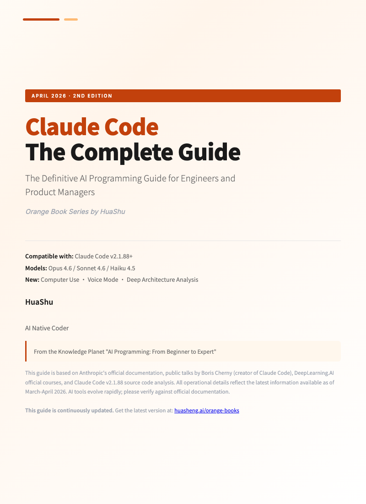

**English** | [中文版 README](README_zh.md)

  

# Claude Code: The Complete Guide

> Orange Book Series by HuaShu (花叔)

<!-- BOOK-PROMO-START 《图解Agent Skills》京东横幅，2026-12-21下线 -->

<!-- BOOK-PROMO-END -->

The definitive guide to Claude Code — Anthropic's terminal-native AI programming tool. From installation to shipping products, this book covers everything you need to become productive with agentic coding.

Written by someone who has never written a single line of code by hand, yet built an App Store #1 paid app, published 7 technical books, and runs a 300K-follower content operation — all powered by AI.

## Download

| Version | PDF |
|---------|-----|
| 中文版 (Chinese) | [**Claude-Code-Complete-Guide-zh-v260411.pdf**](Claude-Code-Complete-Guide-zh-v260411.pdf) |
| English | [**Claude-Code-The-Complete-Guide-v260411.pdf**](Claude-Code-The-Complete-Guide-v260411.pdf) |

> 💡 Download the PDF for the best reading experience. GitHub's online preview may not render properly.

## What This Book Covers

| Part | Chapters | Topics |
|------|----------|--------|
| **Getting Started** | §01–§03 | Why Claude Code · Installation · Your first project |
| **Core Skills** | §04–§06 | Workflows (Plan/Auto mode) · CLAUDE.md · Prompting & context engineering |
| **Advanced Practice** | §07–§10 | Skills, Hooks & MCP · Multi-agent collaboration · Building products · Mental models |
| **Real-World Projects** | §11–§14 | Chrome extension · Content automation · iOS app (App Store #1) · Slash commands |
| **Exercises** | 15 hands-on tasks | Progressively build your skills |
| **Appendices** | A–G | Source code analysis · Chinese model integration · Command reference · FAQ · Glossary · Agentic coding trends · CLAUDE.md templates |

## Who Is This For

- **Engineers** who want 10x productivity — let Claude Code handle boilerplate, debugging, testing, and CI/CD while you focus on architecture and product thinking
- **Product Managers** who want to build MVPs themselves — turn a weekend into a working prototype without waiting for dev resources
- **Entrepreneurs** building one-person companies — Claude Code gives one person the development capacity of a small team

No prior AI programming experience required. We start from zero but don't linger on basics.

## Preview

  
  

## Orange Book Series

This is one of 7+ books in the Orange Book (橙皮书) series — practical, hands-on guides for AI-native builders:

- **Claude Code: The Complete Guide** ← you are here
- Claude Code Source Code Analysis
- Harness Engineering
- Agent Skills
- OpenClaw: Build Your Own AI
- Gemma 4
- Polymarket Guide

Visit [huasheng.ai](https://www.huasheng.ai/) for the full collection.

## About the Author

**HuaShu (花叔)** · AI Native Coder · Indie Developer

Creator of Kitty Light (小猫补光灯, App Store #1 Paid App), author of 7 Orange Books, 300K+ followers across platforms. Built all products entirely with AI — never written a single line of code by hand. Featured on CCTV and People's Daily as a representative of the "hand-crafted economy" movement.

- X/Twitter: [@AlchainHust](https://x.com/AlchainHust)
- YouTube: [@Alchain](https://www.youtube.com/@Alchain)
- Bilibili: [花叔](https://space.bilibili.com/14097567/)
- WeChat Official Account: 花叔
- Website: [huasheng.ai](https://www.huasheng.ai/)

## 📚 Read Online on WorkBuddy

This book is also available on WorkBuddy's knowledge base, one page per chapter — or just drop the link into your agent as context.

https://www.workbuddy.cn/space/d/cY2uZj6drEgu0MQnKRI0li

All orange books: https://www.workbuddy.cn/space/d/YcllWXknAUoMk6lFSWdfbI
## License

This work is licensed under [CC BY-NC-SA 4.0](http://creativecommons.org/licenses/by-nc-sa/4.0/). You are free to share and adapt for non-commercial purposes with attribution.
