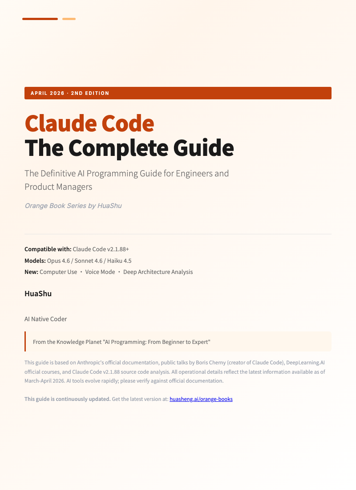

[English README](README.md) | **中文**

  

# Claude Code 从入门到精通

> 橙皮书系列 · 花叔 著

面向工程师与产品经理的AI编程完全指南。从安装到独立构建产品，这本书覆盖了用Claude Code进行Agent式编程你需要知道的一切。

作者从未手写过一行代码，却用AI做出了App Store付费榜第一的产品、出版了7本技术书、运营着30万粉丝的自媒体矩阵。

## 下载

| 版本 | PDF |
|------|-----|
| 中文版 | [**Claude-Code-Complete-Guide-zh-v260411.pdf**](Claude-Code-Complete-Guide-zh-v260411.pdf) |
| English | [**Claude-Code-The-Complete-Guide-v260411.pdf**](Claude-Code-The-Complete-Guide-v260411.pdf) |

> 💡 PDF 文件建议下载后阅读，体验更佳。GitHub 在线预览可能无法完整渲染。

## 本书内容

| 部分 | 章节 | 主题 |
|------|------|------|
| **起步** | §01–§03 | 为什么是Claude Code · 安装配置 · 你的第一个项目 |
| **核心能力** | §04–§06 | 核心工作流（Plan/Auto模式）· CLAUDE.md · 进阶对话技巧 |
| **进阶实战** | §07–§10 | Skills、Hooks与MCP · 多Agent协作 · 构建完整产品 · 心智模型 |
| **实战项目** | §11–§14 | Chrome扩展 · 内容创作自动化 · iOS App（付费榜第一）· 斜杠命令 |
| **练习** | 15个动手任务 | 循序渐进提升技能 |
| **附录** | A–G | 源码分析 · 国内模型接入 · 命令参考 · FAQ · 术语表 · Agentic Coding趋势 · CLAUDE.md模板集 |

## 适合谁读

- **工程师**：想提高10倍效率，把精力从样板代码转移到架构决策和产品思考
- **产品经理**：想自己做MVP，一个周末做出能跑的原型
- **创业者**：想实现一人公司，一个人拥有一个小团队的开发能力

不需要AI编程经验。从零开始，但不会在基础概念上磨叽。

## 橙皮书系列

这是橙皮书系列7+本书中的一本，面向AI Native Builder的实战指南：

- **Claude Code 从入门到精通** ← 你在这里
- Claude Code 源码解析
- Harness Engineering
- Agent Skills
- OpenClaw：养一只你自己的AI
- Gemma 4
- Polymarket 指南

访问 [huasheng.ai](https://www.huasheng.ai/) 获取全部橙皮书。

## 关于作者

**花叔** · AI Native Coder · 独立开发者

代表作：小猫补光灯（App Store付费榜Top 1），橙皮书系列作者，自媒体30万+粉丝。所有产品均由AI完成开发，从未手写过一行代码。被人民日报、央视新闻作为「手搓经济」代表报道。

- X/Twitter: [@AlchainHust](https://x.com/AlchainHust)
- YouTube: [@Alchain](https://www.youtube.com/@Alchain)
- B站: [花叔](https://space.bilibili.com/14097567/)
- 公众号: 花叔
- 官网: [huasheng.ai](https://www.huasheng.ai/)

## 📚 在线阅读（WorkBuddy）

本书已同步到 WorkBuddy 资料库：每章一个网页，也可以直接把链接丢给你的 Agent 当上下文。

https://www.workbuddy.cn/space/d/cY2uZj6drEgu0MQnKRI0li

全部橙皮书入口：https://www.workbuddy.cn/space/d/YcllWXknAUoMk6lFSWdfbI
## 许可证

本作品采用 [CC BY-NC-SA 4.0](http://creativecommons.org/licenses/by-nc-sa/4.0/) 许可证。可自由分享和改编，但需署名、非商业性使用、相同方式共享。
